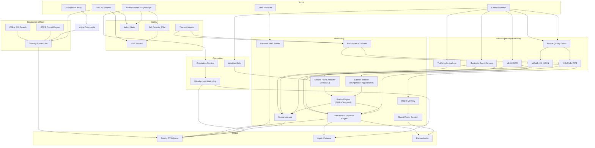

> Historical README preserved during repository cleanup on 2026-10-27.
> Counts, capability claims and roadmap entries describe earlier work.
> Use the root README and dated evaluation reports for current entry points.

# Bagdar

Offline-first mobility **safety prototype** for visually impaired pedestrians.
Bagdar is a supplementary aid. It does not replace a white cane, guide dog,
orientation and mobility training, or the user's judgment.

**Core Safety is not authorized for unsupervised assistive use.** Generic
obstacle alerts remain in `shadow` until
`docs/generic-obstacle-validation-report.md` names a specific build.


-3DDC84?logo=android&logoColor=white)


---

## Verified current state

Facts about this repository, not a safety certification.

The 2026-10-04 opt-in motion experiment meets its known desktop timing gate:
30/30 test risk frames arrive within 100 ms in each of three trials with live
NCNN. The separate Windows native matcher is not connected to phone guidance;
real metric-provider calibration and device validation remain outstanding.
See [the concurrent-load evaluation](../../docs/camera-fast-motion-load-evaluation-2026-10-04.md).

The [paired Blender baseline](../../docs/blender-paired-scenes-evaluation-2026-10-04.md)
contains 12 animated synthetic sequences (132 frames) with real pinned
YOLO/MiDaS inference. The separate
[confidence-authority correction](../../docs/blender-paired-correction-evaluation-2026-10-04.md)
passes the same scene quality limits: zero hazardous continues, six timely
hazard stops out of six sequences, and zero false imminent decisions in both
depth modes. The separate
[visible-body experiment](../../docs/blender-visible-body-evaluation-2026-10-04.md)
adds 252 independent first-return depth packets and frozen-state scans.
It localizes some floor components, but incomplete nearby body/floor coverage
keeps all 55 traversable moving frames stopped. All twelve two-second scans
are stale under the unchanged 100 ms policy.
The separate [static scan coverage experiment](../../docs/blender-scan-coverage-evaluation-2026-10-04.md)
uses 12 request-derived views and independent optical bounds. On these known
frozen layouts, all six passable volumes have full body/floor coverage, all
six hazards remain blocked, and none is incorrectly cleared. All twelve
2.2-second scans are stale under the strict 100 ms policy. This source is
only a synthetic benchmark input; neural models and phone guidance are unchanged.
All **1577 Flutter tests pass** (one skipped), static analysis has no issues,
and the latest full **Core RC passes 57/57 required checks**. Its saved receipt
is `docs/_baseline_logs/blender_scan_complete_core_rc_v1.json`.
These known synthetic regressions provide no model, device or assistive
promotion.

| Item | Reality |
| --- | --- |
| Minimum Android | **API 30 (Android 11+)**, not Android 5 |
| Application ID | `com.example.bagdar` (placeholder; not a public identity) |
| Release signing | still uses the **debug** keystore |
| Packaged detectors | YOLOv8n INT8 (~3.2 MB) and MiDaS Small NCNN (~32 MB) |
| Kazakh ASR/TTS/OCR payloads | **not shipped** — language-pack ZIPs are placeholder-sized; espeak/Paddle directories are README-only |
| Pilot-city map / GTFS | **not packaged** |
| Generic obstacles | default **`shadow`**; `assistive` is blocked |
| ARCore metric depth | experimental; not a single-owner camera path |
| Device / walking / TalkBack evidence | **not recorded** in this tree |
| FPS, thermal, battery numbers in older copy | **unverified engineering hypotheses** — not release evidence |

Core runtime (compile-time `BuildProfile.core`, default flavor): camera and
orientation lifecycle, YOLO + relative NCNN depth, generic geometry in
shadow, surface/drop heuristics, alert arbitration, TTS/haptic, manual SOS,
fall countdown, minimal settings. Deferred experiments (bazaar/livestock,
acoustic/VLM/sonar, BLE mesh/smart-cane, indoor trail, payment SMS, object
finder, transit, charging jobs, phone-abandoned) stay in source but **do not
initialize** in Core.

Languages: Russian, Kazakh, and English **UI/TTS copy**. Native Kazakh ASR
and Paddle OCR are not production-ready in this tree.

The app never claims that a path is clear, that a route is safe, or that it
is safe to cross.

---

## Planned / research

Items below are research or future Core Mobility work. They are **not**
verified product capabilities of the Core artifact.

- one-city offline pedestrian navigation after Core Safety gates pass
- GTFS / public transit
- bazaar and livestock modes
- acoustic world model, sonar, VLM scene Q&A
- BLE mesh / smart-cane
- indoor trail memory
- object memory / finder
- payment SMS reading
- on-device Kazakh ASR/TTS/OCR once real models are packaged
- ARCore as a single camera owner (blocked on a device spike)

Research builds: `flutter build apk --flavor research --dart-define=BAGDAR_RESEARCH=true`.

See `docs/bagdar-core-scope.md` and `docs/bagdar-core-hardening-master-plan.md`.

<!-- TODO: Add demo video or GIF here -->
<!--  -->

---

## Why Bagdar Exists

An estimated **2.2 billion people** worldwide live with some form of vision impairment ([WHO, 2023](https://www.who.int/news-room/fact-sheets/detail/blindness-and-visual-impairment)). The vast majority reside in low- and middle-income countries where reliable internet connectivity, modern smartphones, and accessible urban infrastructure cannot be taken for granted.

Existing assistive apps overwhelmingly depend on cloud APIs for object recognition, route planning, or scene description. This creates a hard prerequisite, a stable data connection, that excludes precisely the users who need these tools the most.

**Bagdar** is designed so detection, depth, and (later) pedestrian routing
can run on-device. Cloud APIs are not required for the Core safety loop.
Target hardware and price points are **not measured in this tree**.

The app currently supports **Russian**, **Kazakh**, and **English** – covering regions where accessible technology options are scarce.

---

## Research / historical capability notes

The tables below describe **implemented or sketched modules**, not Core
release claims. FPS ranges, dollar-price hardware targets, and “runs on
Android 5” statements that may appear further down are **unverified**.

### 🔍 Vision Pipeline

| Feature | How It Works |
|---|---|
| **Object detection** | YOLOv8n quantized to INT8 (~3.2 MB). On-device FPS is **unmeasured** here |
| **Depth estimation** | MiDaS v2.1 Small via NCNN FP16 (~32 MB) with Vulkan GPU acceleration: monocular depth without LiDAR or ToF sensor |
| **Ground plane analysis** | RANSAC-based plane fitting on the depth map. Detects potholes, steps, curbs, slopes, and overhead obstacles by measuring deviations from the estimated ground surface |
| **Multi-object tracking** | Kalman filter with Hungarian assignment and appearance embedding. Tracks identity across frames, detects approaching vehicles via bounding-box area rate, and validates distance with MiDaS metric cross-checks |
| **Traffic light recognition** | Direct YUV colorimetry on the camera stream using three-zone brightness analysis and per-color spatial fraction sanity checks to filter false positives. No separate model required |
| **Synthetic event camera** | Heuristic pipeline using Luma-grid differencing across left/center/right sectors. Detects fast-moving objects entering the periphery with auto-exposure transition suppression to prevent lighting false-alerts |
| **Crowd grouping** | Dynamically groups 3 or more people into a single 'group ahead' alert to prevent TTS spam and ensure critical vehicle threats remain audible |
| **Size-sanity escalation** | Hazards are automatically promoted to critical priority if they occupy a dangerous fraction of the frame (>55-75%) or if their approach distance rapidly halves |
| **Glass door detection** | Luma variance analysis identifies transparent surfaces that depth models misinterpret as open space |
| **Slippery surface warning** | Luma pattern analysis for high-reflectance wet or polished floors. Centre-corridor slippery hazards auto-promote to critical when the user is walking |
| **Frame quality guard** | Laplacian-variance blur detection + exposure analysis. Rejects frames that would produce unreliable detections |
| **Weather gate** | Luminosity variance + average brightness classifier with hysteresis. Detects rain, fog, and glare that degrade depth-map accuracy. Adjusts pedestrian detection thresholds and disables non-critical depth features while preserving stairs-down detection |
| **Sensor fusion engine** | Combines depth hazard scores with YOLO confidence via EMA-smoothed temporal filtering. Reduces false positives by requiring multi-frame confirmation before alerting |
| **Context Modes (Bazaar/Livestock)** | Custom threshold tuning for crowded bazaars (shorter crowd cooldowns, prioritized low/hanging obstacles) and voice alerts for animals (cows, horses, sheep, dogs, cats, birds) with estimated metric distance |
| **Acoustic World Model** | Environmental audio classifier (horn blasts, sirens, dogs, crowds, construction, trams, bikes) with stereo bearing direction and RT60 reverberation room-type classifier (indoor vs outdoor) |

### 🗣️ Accessible Interface

| Feature | Details |
|---|---|
| **Priority TTS queue** | Three-tier system (critical → warning → info) with interrupt semantics: critical alerts preempt all queued speech. Stale message pruning, per-track deduplication, stall watchdog with automatic recovery |
| **Scene Narrator** | On-demand comprehensive scene description. Synthesizes detected objects, depth hazards, traffic lights, and OCR text into a natural language snapshot with directional filtering |
| **Object Memory** | Voice-activated object finding. Users can command the system to "remember" an object, and later "find" it using a Y-histogram visual backend and a continuous proximity beacon for spatial guidance. The beacon accelerates its pulse rate as the user approaches the target |
| **Audio session management** | Proper ducking of background audio, interruption handling (phone calls, other apps), automatic route recovery when audio output changes |
| **Voice commands** | 30+ commands across 3 languages. Natural-language prefixes for navigation ("веди в аптеку", "take me to pharmacy", "дәріханаға жол көрсет"). Fall cancellation, SOS, mode switching, speech rate / volume / language control via voice |
| **Payment SMS reader** | Intercepts, parses, and reads aloud payment and balance SMS messages. Automatically extracts payment amounts, currency, and direction (incoming/outgoing) |
| **Haptic feedback** | Configurable vibration strength (weak / normal / strong). Patterns encode spatial direction (left/right/center) and urgency level |
| **Earcon audio cues** | Non-speech audio signals for events that don't warrant spoken alerts. Independently adjustable volume |
| **Pitch-black screen** | Full-black UI mode for zero display power draw while the vision pipeline continues running |
| **Guide dog mode** | Suppresses alerts that conflict with trained guide dog behavior; the dog handles obstacle avoidance, while the app provides supplementary information only |
| **Verbosity control** | Three levels (minimal / normal / detailed) integrated into the alert filter to reduce alert fatigue by suppressing lower-priority announcements |
| **Gesture tutorial** | Interactive 6-step onboarding that teaches tap, double-tap, long-press, horizontal swipe, vertical swipe, and two-finger SOS gesture, complete with voice prompts and earcon feedback |
| **Accessibility preferences** | Configurable speech rate, dominant hand, SOS trigger method, per-channel volume control, and alert frequency |
| **Scene QA VLM Companion** | Voice-activated natural language scene Q&A utilizing MobileVLM, MiniCPM, or Phi vision models via native llama.cpp integration (`bagdar/vlm_engine`) when resource gates pass |
| **Kazakh Speech Stack & OCR dictionary** | Constrained grammar Vosk-kk ASR model for offline commands, and PaddleOCR post-correction utilizing Cyrillic confusion pairs |

### 🧭 Offline Navigation

| Feature | Details |
|---|---|
| **Pedestrian routing** | Offline route computation from OpenStreetMap data. No server API involved |
| **Turn-by-turn guidance** | Voice instructions with compass-based relative direction ("turn left", "go straight"). Periodic progress updates |
| **GPS reliability gate** | Automatically pauses turn-by-turn guidance and issues a verbal warning if GPS accuracy degrades severely or becomes stale |
| **Off-route detection** | Automatic rerouting when GPS indicates significant deviation. Cooldown prevents alert spam in noisy GPS environments |
| **GPS drift rejection** | Pedometer cross-validation: large GPS jumps are ignored if the step counter disagrees, which is critical for indoor/urban-canyon accuracy |
| **Public transit** | GTFS data stored locally in SQLite. Nearest stop search, route lookup, schedule queries, stop-by-stop ride tracking, auto-boarding detection via speed sensor |
| **2GIS integration** | Optional online fallback for cities with 2GIS coverage. Place search, pedestrian routing, and multimodal transit directions (bus, tram, trolleybus, metro) via the 2GIS Catalog + Routing API. Activates only when an API key is configured; the app remains fully functional without it |
| **Offline POI search** | FTS5-indexed SQLite with Levenshtein fuzzy matching. Finds places by name even with typos or partial input |
| **Waypoints** | Save and navigate back to important locations |
| **Indoor Trail Retracing** | Step heading + magnetic signature + IMU recording for indoor routes, tracked and retraced offline using a low-overhead Particle Filter |

### 🛡️ Safety Systems

| Feature | Details |
|---|---|
| **Fall detection** | IMU-based (accelerometer + gyroscope). Two detection classes: **Class A** (sharp tumble) — three-phase FSM: freefall → impact → stillness with gyroscope rotational confirmation; **Class B** (slow vertical collapse) — sustained above-threshold deceleration → prolonged stillness, gated on prior walking state. Phone-drop and placed-down false positives suppressed via low-rotation, no-freefall, and stationary-impact heuristics. Automatic SOS countdown with voice cancellation. Second-fall-during-lockout detection queues follow-up SMS |
| **SOS** | One-touch emergency SMS with GPS coordinates and Google Maps link. Native SMS dispatch with retry + fallback to 112. Follow-up SMS on repeated falls during SOS lockout window |
| **Misalignment watchdog** | Detects sustained phone misalignment (too high / too low / flat) while walking with no recent detections. Distinguishes "empty scene" from "camera is blind" via depth-pipeline confidence monitoring. Verbal warning escalation (warning → critical) gated on depth-blind confirmation; tactile triple-tap haptic channel independent of speech |
| **Indoor auto-switch** | GPS quality + motion state classifier with hysteresis. Detects transition into GPS-denied environments (elevators, malls). Adjusts detection cadence to prevent battery-saving delays when you're standing in front of elevator doors |
| **Thermal protection** | Real-time battery temperature + thermal status monitoring. Four-tier severity system with committed dwell to prevent oscillation. Adaptive YOLO input size: swaps to 320×320 model at hot/critical thermal state for ~30–40% inference time reduction. Issues verbal 'reduced mode' TTS announcements when depth features are suspended |
| **Orientation monitor** | Accelerometer-based device pitch and roll tracking. Feeds the misalignment watchdog and dynamically adjusts the depth-map crop-top fraction to match camera viewing angle. Excessive roll detection with enter/exit hysteresis demotes plane-geometry hazards |
| **Field telemetry logger** | Optional on-device JSONL session recorder. Logs detections, depth hazards, TTS events, throttler decisions, fall stages, thermal transitions, weather gate changes, camera stalls, and resource snapshots. Post-processed offline via `tools/analyze_session.py` |
| **Settings backup** | QR code export/import of all user preferences to enable caregivers to configure one device and replicate settings across others. Excludes PII (like emergency contacts). Import requires a deliberate long-press confirmation designed for motor-impaired users |
| **Winter Mode** | Automated cold-weather operations (tripped at battery temp $\le 5^\circ\text{C}$). Adapts thermal severity levels, promotes slippery surfaces to critical, disables weather overrides for stairs-down safety, and speaks a periodic warning |
| **Phone Abandoned Detector** | Watchdog checking if a stationary phone with a frozen camera is left behind on a surface, alerting with escalating vibrations and periodic heartbeat tones |
| **Charging Job Scheduler** | Resource-gated scheduler for running background training / adapter optimization tasks (requires charger, Wi-Fi, battery $> 40\%$, normal thermal, and normal memory) |

---

## Architecture



---

## Offline Architecture

Bagdar's offline capability is not an afterthought; it is the foundational architectural decision that shaped every component.

### On-Device ML Inference

Object detection runs via **TensorFlow Lite**, depth estimation via **NCNN** with Vulkan GPU acceleration:

| Model | Format | Size | Purpose | Acceleration |
|---|---|---|---|---|
| YOLOv8n INT8 | TFLite | 3.2 MB | Object detection (80 COCO classes) | NNAPI → GPU delegate → CPU fallback |
| MiDaS v2.1 Small FP16 | NCNN | 32 MB | Monocular depth estimation | Vulkan GPU → CPU (OpenMP) |

At first launch, `DeviceCapabilityProbe` runs a **hardware capability assessment**, probing for ARCore depth sensor support, NCNN + Vulkan availability, and Android SDK level. The result determines which depth estimation tier the device will use:

```
Hardware Depth (ToF/structured light) → Best accuracy, zero ML cost
        ↓ not available
NCNN + Vulkan GPU → Good accuracy, hardware-accelerated
        ↓ not available
NCNN + CPU (OpenMP) → Good accuracy, higher power draw
        ↓ too slow / init failed
Focal-length heuristic → Basic distance estimation, minimal CPU
```

NCNN self-monitors reliability: after 3 inference failures within 5 minutes, the provider permanently disables itself and persists the decision (no further init attempts in future sessions).

This probe result is **cached across launches**; the assessment runs once and is persisted in shared preferences.

### Offline Data Stack

| Data Source | Format | Use Case |
|---|---|---|
| OpenStreetMap | Compressed routing graph | Pedestrian navigation, POI database |
| GTFS | SQLite database | Bus routes, stops, schedules, transit planning |
| POI Index | FTS5-indexed SQLite | Place name search with fuzzy matching |
| User Waypoints | SQLite | Saved locations for return navigation |

**Packaged ML models in this tree**: YOLO INT8 ~3.2 MB + MiDaS NCNN ~32 MB.
Regional map/transit data is **not** included. Debug APK size is not the
product footprint.

---

## Performance on Mid-Range Hardware

The following scheduling description is the **software design**. Named-device
FPS, thermal, and battery measurements are **not** in this repository and
must not be quoted as product performance.

### Adaptive Inference Scheduling

The `PerformanceThrottler` continuously monitors inference latency, thermal state, battery level, memory pressure, and user motion to dynamically adjust the processing cadence:

```
                   ┌─────────────┐
                   │ Inference   │──┐
                   │ Latency     │  │
                   └─────────────┘  │
                   ┌─────────────┐  │    ┌──────────────────┐
                   │ Thermal     │──┼───▶│ Performance      │───▶ Detection Interval
                   │ Severity    │  │    │ Throttler        │───▶ MiDaS Interval
                   └─────────────┘  │    │                  │───▶ UI Refresh Rate
                   ┌─────────────┐  │    │ (dynamic         │───▶ OCR Interval
                   │ Battery     │──┤    │  multi-signal    │
                   │ Level       │  │    │  governor)       │
                   └─────────────┘  │    └──────────────────┘
                   ┌─────────────┐  │
                   │ Motion      │──┤
                   │ State       │  │
                   └─────────────┘  │
                   ┌─────────────┐  │
                   │ Memory      │──┘
                   │ Pressure    │
                   └─────────────┘
```

### Key Optimization Strategies

| Strategy | Mechanism |
|---|---|
| **Thermal burst scheduling** | At critical temperature: process 3 frames at reduced intervals, then idle for a full cycle. Ensures hazards are not missed during thermal throttling |
| **Motion-aware cadence** | Stationary user → longer intervals (battery savings). Unstable motion → shorter intervals (heightened vigilance). Indoor override: stationary-in-elevator penalty is removed |
| **Memory-pressure response** | Low memory → increased detection intervals. Critical memory → MiDaS disabled entirely, detection intervals significantly increased |
| **Stall watchdog** | Detects pipeline stalls with thermal-state-aware thresholds. Automatically recovers detection loop if inference hangs |
| **Weather-degraded mode** | Adjusts pedestrian detection thresholds and raises score floors in degraded visibility. Stairs-down detection is never fully disabled — instead requires higher MiDaS score (≥0.715) to preserve fall-cliff safety |

### Approximate Performance Characteristics

| Metric | Mid-Range (e.g. Snapdragon 680) | Upper Mid-Range (e.g. Snapdragon 778G) |
|---|---|---|
| YOLOv8n inference | ~45 ms | ~22 ms |
| MiDaS NCNN inference | ~140 ms (Vulkan) | ~65 ms (Vulkan) |
| Effective detection FPS | 8–12 | 18–25 |
| Estimated battery drain/hr | ~15% | ~10% |

> **Note**: These are estimated figures based on development testing. Formal benchmarking across a wider range of devices is planned.

---

## Supported Languages

| | Russian | Kazakh | English |
|---|:---:|:---:|:---:|
| Voice commands | ✅ 30+ commands | ✅ 30+ commands | ✅ 30+ commands |
| TTS alerts | ✅ | ✅ | ✅ |
| OCR | ✅ | ✅ | ✅ |
| Navigation instructions | ✅ | ✅ | ✅ |
| Onboarding UI | ✅ | ✅ | ✅ |
| Voice-configurable settings | ✅ | ✅ | ✅ |

Language can be switched via voice command at any time ("русский язык" / "қазақ тілі" / "english language"). If the device's TTS engine does not support the selected language, Bagdar guides the user to install the missing language pack and falls back to English.

---

## Project Structure

```
bagdar/
├── lib/
│   ├── camera/            # Camera pipeline architecture
│   │   ├── alert_manager       # Alert routing, cooldowns, deduplication
│   │   ├── frame_quality_guard # Blur + exposure rejection
│   │   ├── depth_pipeline_controller  # Depth provider lifecycle
│   │   ├── camera_lifecycle_controller # Camera start/stop FSM
│   │   ├── fall_countdown_controller   # Fall → SOS countdown UI
│   │   ├── object_finder_session       # Visual object search session
│   │   ├── stall_watchdog      # Inference hang detection + recovery
│   │   └── voice_command_dispatcher    # Voice → action routing
│   ├── services/          # 71 service modules
│   │   ├── tts_service         # Priority speech queue with interrupt semantics
│   │   ├── navigation_service  # Turn-by-turn walk + transit navigation
│   │   ├── depth_provider      # Multi-tier depth estimation orchestrator
│   │   ├── ncnn_depth_provider # NCNN-based MiDaS inference + auto-disable
│   │   ├── ncnn_depth_bridge   # Native FFI bridge to NCNN C++ library
│   │   ├── fall_detector        # Dual-class IMU fall detection FSM
│   │   ├── traffic_light_analyzer  # YUV colorimetric traffic light classification
│   │   ├── thermal_monitor     # Battery temp + thermal status polling
│   │   ├── indoor_gate         # GPS quality + motion indoor classifier
│   │   ├── motion_prealert     # Peripheral intrusion detector
│   │   ├── misalignment_watchdog  # Sustained phone misalignment detector
│   │   ├── orientation_service # Device pitch/roll tracking + crop adaptation
│   │   ├── weather_gate        # Visibility degradation classifier
│   │   ├── twogis_service      # 2GIS place search + routing (optional online)
│   │   ├── field_logger        # On-device JSONL telemetry recorder
│   │   ├── foreground_service  # Android foreground service for background nav
│   │   ├── proximity_beacon_service  # Distance-adaptive audio proximity beacon
│   │   ├── ch_router           # Contraction hierarchy pedestrian router
│   │   ├── gtfs_service        # Offline transit data queries
│   │   ├── offline_poi_service # FTS5 + Levenshtein place search
│   │   ├── device_capability   # Hardware probe + depth tier selection
│   │   ├── memory_monitor      # Runtime memory pressure tracking
│   │   ├── feature_usage_tracker  # Feature analytics + tutorial tracking
│   │   ├── map_package_manager # City map package download + extraction
│   │   ├── bazaar_livestock_service # Bazaar and livestock context modes
│   │   ├── acoustic_world_model # Sound event environment mapper
│   │   ├── oscp_service        # Open Smart-Cane BLE pod client
│   │   ├── mesh_buddy_alert_service # Peer-to-peer BLE mesh telemetry exchange
│   │   ├── indoor_trail_recorder # Walk-step heading & magnetic signature recorder
│   │   ├── particle_trail_localizer # Particle Filter trajectory localizer
│   │   ├── charging_job_scheduler # Gated background training task controller
│   │   ├── phone_abandoned_detector # Ceiling/table watchdog
│   │   ├── scene_question_service # VLM Companion voice Q&A engine
│   │   ├── winter_mode_service # Cold-weather parameter adjuster
│   │   ├── vosk_kk_recognizer  # Offline Kazakh Vosk ASR backend
│   │   ├── kk_dictionary       # OCR Cyrillic confusion-pair correction
│   │   └── ...                 # SOS, compass, haptic, voice, battery, etc.
│   ├── utils/             # Vision pipeline core
│   │   ├── ground_plane_analyzer  # RANSAC plane fitting + hazard classification
│   │   ├── fusion_engine       # EMA-smoothed multi-sensor hazard confirmation
│   │   ├── decision_engine     # Corridor width analysis + navigation decisions
│   │   ├── blur_detector       # Laplacian-variance frame sharpness scoring
│   │   ├── performance_throttler  # Adaptive multi-signal cadence governor
│   │   ├── distance_utils      # Metric distance estimation
│   │   └── alert_filter        # Deduplication + priority routing
│   ├── tracker/           # Multi-object tracking
│   │   ├── tracker             # Kalman + Hungarian assignment
│   │   ├── kalman_box_tracker  # Per-track state estimation
│   │   ├── hungarian           # Optimal assignment solver
│   │   └── appearance          # Visual feature similarity
│   ├── models/            # Domain models + i18n (158 KB string table)
│   ├── viewmodels/        # MVVM presentation layer
│   ├── widgets/           # UI overlays, controls, HUD
│   ├── screens/           # Settings QR export/import
│   ├── gesture_tutorial_screen.dart  # Interactive gesture onboarding
│   ├── features/onboarding_v2/        # Sole onboarding entry, training and readiness checks
│   └── camera_screen.dart # Main orchestration layer
├── tools/
│   ├── analyze_session.py # Field telemetry post-processor
│   └── build_source_deposit.py  # Source code archival tool
├── scripts/               # Data pipeline tooling
│   ├── build_ch_graph.py  # OSM PBF → binary CH routing graph
│   ├── build_gtfs_db.py   # GTFS ZIP → SQLite transit database
│   ├── build_poi_db.py    # OSM → FTS5-indexed POI database
│   ├── package_city.py    # Bundle city map package (.bagdar)
│   └── parse_perf_logs.py # Performance log analysis
├── assets/
│   ├── yolov8n_int8.tflite
│   ├── yolov8n_320_int8.tflite  # Thermal-fallback small model
│   ├── midas_small.ncnn.param
│   ├── midas_small.ncnn.bin
│   └── labels.txt
└── test/                  # 58 test files
```

**132 Dart source files** · **~1382 KB** of application code · **71 service modules** · **58 unit test files**

---

## Getting Started

### Requirements

- Flutter SDK 3.41 (see `flutter --version` on the machine that last built)
- Android device (physical device required for camera, IMU, GPS, vibration)
- Android 11+ (API 30). `minSdk` in Gradle is 30.

### Build & Run

```bash
# Install dependencies
flutter pub get

# Run on connected device
flutter run

# Analyze code
flutter analyze
```

Every launch enters the new onboarding flow. New users choose a language and access
mode, acknowledge limits, verify feedback, complete camera-free exercises, and
check camera access, device state and phone alignment. Returning users resume their
saved checkpoint and repeat current-session readiness checks before stationary
camera inspection in scan mode. No feature flag or legacy completion setting can
open the old onboarding or bypass this entry. See
[the current wireflow](../../docs/bagdar-onboarding-wireflow.md).

### Required Permissions

| Permission | Purpose |
|---|---|
| Camera | Real-time vision pipeline |
| Microphone | Voice commands |
| Location | Navigation, SOS coordinates |
| SMS | Native SOS message dispatch |
| Sensors | Fall detection (accelerometer, gyroscope) |
| Vibration | Haptic directional feedback |

---

## Roadmap

- [ ] Formal benchmarking suite across 10+ device models
- [ ] Expanded hazard detection: construction zones, uneven terrain grading
- [ ] Crowd-sourced hazard reporting between users
- [ ] iOS support
- [ ] Additional language packs (Turkish, Arabic, Hindi)
- [ ] Integration with municipal accessibility APIs where available
- [ ] Indoor wayfinding via BLE infrastructure beacons

---

## License

This project is licensed under the [MIT License](../../LICENSE) - © 2026 Nurmukhamed Sabit.

---

<p align="center">
  <em>Built to work where infrastructure doesn't.</em>
</p>
