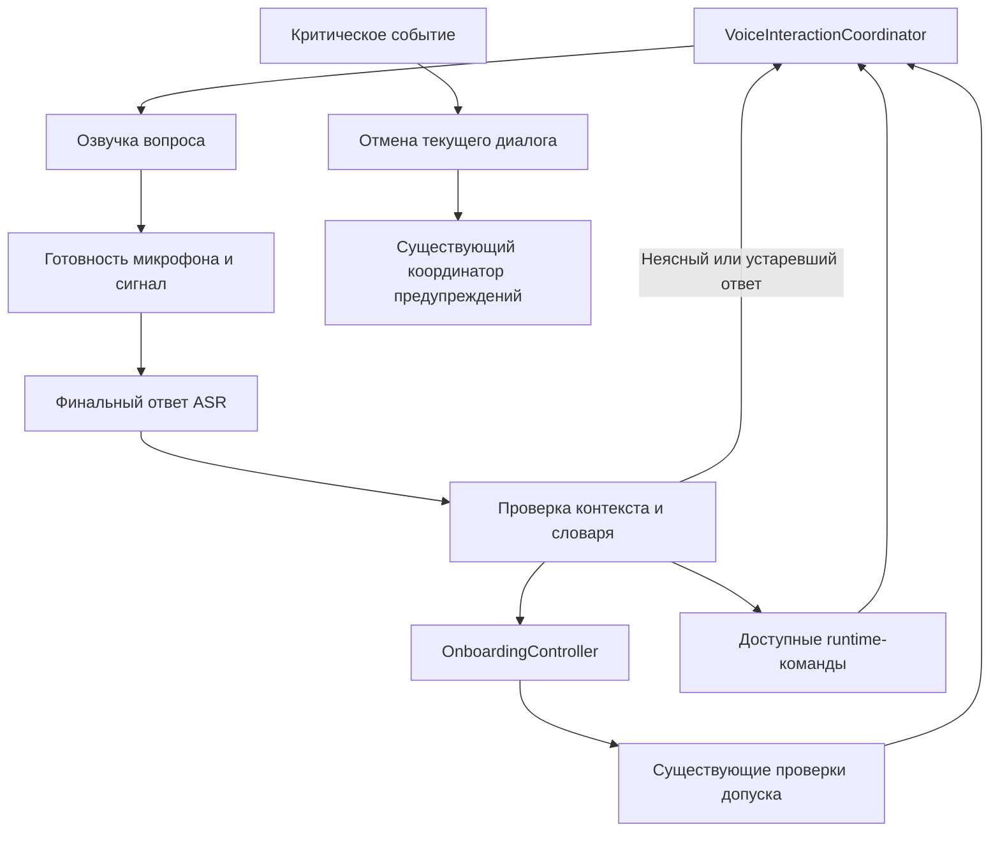

# Bagdar AI: управление голосом и звуковой onboarding

Дата проекта: 12 октября 2026. Обновлено: 14 октября 2026. Статус: реализованы голосовой диалог на всех 12 шагах, короткая повторная проверка, передача управления неподвижному осмотру, ограниченные runtime-команды и диалог настройки речи/оформления. Добавлены локальный детектор-кандидат обращения и отдельная исследовательская проверка; кандидат не прошёл синтетический аудионабор и не выполняет команды. Системные окна требуют доступного средства ОС; реальное прохождение на телефоне ещё не проверено. В шестом срезе обучен компактный CNN, проверены экспорт и отложенные голоса; он также не прошёл проверку и не подключён к приложению. В седьмом срезе подготовлен закреплённый человеческий пилот RU/KK/EN, локальный импорт и отдельный экспорт train/dev/test; человеческих записей пока нет, новое обучение не запускалось. Текущий этап описан в [отчёте седьмого среза](bagdar-voice-wake-stage7-2026-10-14.md); предыдущие этапы — [CNN и отложенные голоса](bagdar-voice-wake-stage6-2026-10-14.md), [исследовательское обращение Vosk](bagdar-voice-wake-stage5-2026-10-13.md), [голосовые настройки](bagdar-voice-settings-stage4-2026-10-13.md), [runtime-команды](bagdar-voice-runtime-stage3-2026-10-13.md), [аппаратные шаги onboarding](bagdar-voice-onboarding-stage2-2026-10-13.md) и [первый срез](bagdar-voice-onboarding-stage1-2026-10-13.md). Автоматическая активация по обращению и полный набор голосовых настроек остаются целевым интерфейсом.

Цель: незрячий пользователь проходит обучение, проверяет готовность и управляет доступными функциями Bagdar без поиска кнопок и касаний экрана. Приложение само объясняет текущий шаг, сообщает, когда слушает, и подтверждает результат действия. Работа голосом должна быть полноценным способом управления наряду с доступным экранным интерфейсом.

Граница первой версии: открытое приложение на переднем плане, настроенный звуковой вывод и предоставленный доступ к микрофону. Первый системный запрос разрешения, запуск приложения из ОС, разблокировка и внешние окна требуют отдельного системного сценария. Нельзя обещать полностью самостоятельный старт на любом ненастроенном Android.

## Что уже есть в коде

| Основа | Текущее поведение | Необходимое дополнение |
| --- | --- | --- |
| `lib/features/onboarding_v2/onboarding_controller.dart` | 12 шагов, озвучка, упражнения, подтверждения пользователя и проверки допуска | Адаптер голосовых намерений к тем же методам контроллера |
| `lib/features/onboarding_v2/onboarding_screen.dart` | Доступные кнопки и фокус; режим «С голосовыми подсказками» | Автоматическое ведение диалога при явно включённом голосовом управлении |
| `lib/features/onboarding_v2/onboarding_gateway.dart` | Вывод речи, вибрация и проверки оборудования; распознавания ответов нет | Отдельный контракт ввода речи, без внедрения микрофона в тренировочные проверки |
| `lib/services/voice_command_service.dart` | Финальные результаты ASR, словари RU/KK/EN, ограниченные сеансы слушания | Контекст вопроса, идентификатор сеанса, сведения о движке/языке, отмена устаревшего результата |
| `lib/camera_screen.dart` | Обычный голосовой ввод запускается долгим нажатием | Активация без касания и общий координатор звука |
| `lib/camera/voice_command_dispatcher.dart` | Выполнение команд, часть функций ограничена Core-политикой | Доступные в текущем состоянии команды и подтверждения значимых действий |
| `lib/camera/fall_countdown_controller.dart` | Отдельное ограниченное слушание отмены при отсчёте после падения | Совместное владение микрофоном с диалогом без изменения аварийного поведения |

Наличие фразы в словаре не означает доступность функции. Например, описание сцены, транспорт и экспериментальный казахский стек имеют ограничения Core. Голосовая справка должна перечислять только разрешённые действия текущей сборки и состояния.

Нынешний общий парсер использует поиск подстроки для части команд. Его нельзя напрямую использовать для согласия, ответов обучения или новых подтверждений SOS: «не согласен» и «согласен» должны оставаться разными ответами.

## Первый запуск и разрешения Android

1. До включения микрофона приложение произносит краткое приветствие на сохранённом или системном языке. Для отсутствующего TTS нужны заранее подготовленные локальные записи приветствия и восстановления. Их ещё предстоит создать и проверить.
2. Приветствие объясняет назначение микрофона и доступный элемент «Включить голосовое управление». Выбор этого элемента через системное средство доступности запускает запрос разрешения. Автоматически открывать запрос при загрузке приложения не следует.
3. Системное окно Android получает ответ пользователя. Bagdar не выдаёт себе разрешение и не считает произнесённое «разрешаю» подтверждением от ОС. После возврата приложение заново читает фактический статус.
4. При предоставленном доступе Bagdar проверяет наличие распознавателя для выбранного языка, проигрывает инструкцию и предлагает пробную команду «Повтори».
5. При отказе остаются озвучка и доступный интерфейс. Приложение объясняет, почему голосовые ответы недоступны; повторного запроса по таймеру нет.

Android показывает собственное окно разрешения; разрешение «только в этот раз» может потребовать нового системного выбора позднее. Поэтому системный участок нельзя считать обязательно одноразовым. [Документация Android](https://developer.android.com/training/permissions/requesting).

Предварительно настроенный Voice Access может быть вариантом системного управления. Однако в опубликованном списке поддерживаемых языков Voice Access нет русского и казахского. Для этих пользователей нельзя обещать, что он решит первый запуск; может понадобиться первоначальная настройка с помощником либо проверенное средство ОС на конкретном устройстве. TalkBack обеспечивает озвучку и доступную навигацию, но сам по себе не заменяет весь сценарий голосовым управлением. [Команды и языки Voice Access](https://support.google.com/accessibility/android/answer/6151854?hl=en).

## Правила диалога

Один вопрос — один короткий ответ. В конце вопроса всегда звучит, что именно можно сказать. За один раз предлагать не больше трёх вариантов. Пользователь может выбирать по названию; номера допустимы только после прочтения соответствующих вариантов.

После завершения речи и освобождения аудиоканала приложение включает распознаватель. Сигнал «слушаю» выдаётся только после подтверждения готовности ввода, а не сразу после вызова `startListening`. Сигнал и вибрация должны отличаться от предупреждения об опасности. Продолжительность окна и допустимую паузу внутри ответа настраивать по проверкам с пользователями; текущие 6 секунд в сервисе не являются подтверждённым UX-нормативом.

На этапе первой реализации микрофон и детектор обращения не принимают команды во время собственной озвучки. Подсказки разбиваются на короткие части с окнами ответа; целевой предел одной части — около 4 секунд, с проверкой для каждого языка. «Повтори», «Медленнее» и «Пауза» принимаются в этих окнах. Обещать прерывание любой звучащей фразы голосом можно только после отдельной проверки одновременного ввода и вывода речи.

| Намерение | Примеры русских фраз | Результат |
| --- | --- | --- |
| Повтор | «Повтори», «Ещё раз» | Повтор текущего вопроса без потери прогресса |
| Ориентация | «Где я в настройке?», «Что можно сказать?» | Название шага, состояние и доступные ответы |
| Темп | «Медленнее», «Быстрее» | Изменение темпа с коротким образцом |
| Назад | «Назад» | Возврат через существующий контроллер |
| Продолжение | «Дальше» | Переход с существующими проверками; не заменяет согласие или ответ упражнения |
| Пауза | «Пауза» | Остановка текущей задачи; отдельное состояние ожидания обращения |
| Возобновление | «Багдар» → «Продолжить» | Возобновление с пояснением текущего состояния |
| Отказ | «Нет», «Не услышал», «Не согласен» | Отказ в контексте конкретного вопроса, без продвижения |

Синонимы RU/KK/EN задаются и проверяются отдельно. Знакомое пользователю название языка не означает наличие работающего ASR для него. В первой версии ограниченный словарь проверяемых команд предпочтителен свободному разговору. LLM не должен самостоятельно предоставлять согласие, отмечать упражнения выполненными или запускать внешние действия.

## Прохождение существующих 12 шагов

| Шаг | Диалог и голосовой ответ | Условие результата |
| --- | --- | --- |
| Язык | «Выберите язык: русский, қазақша, English» | Выбранный язык; голосовой ввод включается только при доступном движке этого языка. На этапе системной настройки выбор остаётся доступным через ОС |
| Способ управления | «Вы будете отвечать сами или с помощником?» | Явный выбор; голосовой ввод и способ отображения хранить раздельно |
| Ограничения | По одному короткому правилу, затем «Понимаю ограничения» или «Объясни» | Личное подтверждение пользователя через `acceptLimits`; «Дальше» его не создаёт |
| Звук и вибрация | Образец обычной речи, образец STOP, вибрация; после каждого отдельный вопрос | «Услышал» и «Почувствовал» привязаны к успешно воспроизведённому образцу; отрицательный ответ оставляет канал непроверенным |
| Приватность | Краткое объяснение микрофона, используемого движка и обработки речи; «Подробнее» | Ознакомление не подменяет разрешение ОС или отдельное согласие на сеть |
| Значения предупреждений | По одному сигналу и объяснению, «Повтори сигнал» | Только объяснение, без выполнения живой команды |
| Практика без камеры | «Это учебный пример. Что вы сделаете?» | «Остановлюсь» → `PracticeAction.stop`; «Проверю» → `check`; «Пауза» и «Продолжить» → `pause` и `resume`. Ошибка не завершает упражнение |
| Камера | «Запросить доступ к камере или отложить?» | «Запросить доступ» открывает системное окно; фактическое разрешение считывается отдельно |
| Проверка устройства | «Проверить устройство»; озвученный результат камеры и температуры | Только результат настоящих проверок; голосовое «всё работает» его не заменяет |
| Положение телефона | Инструкции по реальным данным ориентации, затем личное подтверждение | Свежая проверка и подтверждение пользователя; неизвестное положение не объявляется правильным |
| Неподвижная проверка | «Вы стоите на месте?» — «Стою на месте», затем проверка | Подтверждение и актуальные результаты оборудования |
| Итог | Доступные действия и недостающие проверки; «Начать осмотр» | Существующий допуск `Admission.inspectionOnly`; камера стартует через прежний проверяемый путь |

Режим помощника сохраняет запрет на личные подтверждения до передачи управления. Фраза передачи управления выражает намерение, но не является биометрическим доказательством личности говорящего.

Практика продолжает работать без камеры, геолокации, отправки сообщений и сетевых клиентов. Микрофон — явно включённый канал управления на уровне внешнего координатора. Сам `OnboardingGateway` и контроллер упражнений не начинают запись и не запрашивают разрешения. Это дополнение к прежнему сценарию без микрофона, которое требует обновления описаний приватности и тестов, а не скрытого изменения контракта обучения.

## Работа после обучения

В активном приложении пользователь произносит «Багдар», слышит сигнал готовности и затем команду: «Статус», «Начать осмотр», «Закончить осмотр», «Настройки», «Повтори», «Говори медленнее». Во время текущего вопроса повторять обращение не требуется. После любой команды приложение коротко сообщает, что произошло, либо почему действие недоступно.

Это целевой сценарий обращения. Третий срез пока запускается доступным элементом «Голосовая команда» или прежним долгим нажатием и принимает **одну** команду за ограниченный сеанс. Доступны статус, справка, повтор, медленнее/быстрее, открытие настроек, завершение осмотра при доступном возврате и выключение микрофона. После ответа захват закрывается; новый сеанс требует явной активации. Голосового редактирования всех настроек внутри открытой панели пока нет. SOS и отмена падения не являются обычными командами нового сеанса.

Четвёртый срез продолжает команду «Настройки» отдельным ограниченным диалогом без нового касания: группа → параметр → значение → точная команда «Сохранить». До сохранения это только черновик. Реализованы темп и громкость речи, четыре темы; раздел «Обзор» читает текущий язык и настройки сигналов. Также есть доступный элемент «Голосовые настройки» с явным запуском ввода внутри панели. Диалог ограничен 12 окнами ответа и двумя минутами, завершает микрофон после одной подтверждённой записи и уступает приоритет предупреждениям. Это несколько окон внутри явно включённого диалога, а не постоянное ожидание.

Для ожидания слова «Багдар» нужен отдельный локальный детектор обращения. Его модель, качество, потребление памяти и батареи ещё не выбраны и не проверены. Системный `SpeechRecognizer` и используемый пакет `speech_to_text` рассчитаны на ограниченные сеансы; бесконечный перезапуск текущего ASR нельзя считать готовым решением постоянного ожидания. [Android SpeechRecognizer](https://developer.android.com/reference/android/speech/SpeechRecognizer), [документация speech_to_text](https://pub.dev/packages/speech_to_text).

«Пауза» останавливает задачу/диалог, но оставляет локальное ожидание обращения при включённом голосовом управлении. Это нужно ясно озвучить. «Выключить микрофон» полностью прекращает захват: после этого голосовое возобновление самим Bagdar невозможно. Возврат потребует системного средства управления или доступного элемента интерфейса. Чёрный интерфейс внутри приложения и заблокированный телефон — разные состояния; фоновое и заблокированное использование остаются отдельной задачей.

Настройки должны читаться и изменяться голосом по группам: речь, язык, оформление, сигналы. Прежде чем вводить номер SOS-контакта голосом, нужен отдельный сценарий чтения по цифрам, исправления и подтверждения. QR-импорт, экспорт и внешние редакторы также требуют отдельных сценариев; первый прототип onboarding не означает, что всё приложение уже доступно без касаний.

В текущем голосовом диалоге язык и сигналы только читаются. Их изменение, SOS-контакт, QR и остальные настройки остаются последующими этапами. Успех записи предпочтения, завершение TTS и личное подтверждение слышимости не подменяют друг друга.

## Координация ввода, озвучки и проверок

Предлагаемая структура, имена новых компонентов предварительные:

`VoiceInteractionCoordinator` владеет состояниями `systemPermission`, `speaking`, `listening`, `handling`, `waitingForWake`, `micOff`, `suspended`, `unavailable`. Перед каждым вопросом он создаёт новый `turnId` и сохраняет ожидаемый шаг, упражнение, язык и допустимые ответы. Отдельный `sessionId` защищает от результатов предыдущего запуска.

ASR-адаптер возвращает финальность, текст, язык/движок, идентификаторы сеанса и вопроса, время начала/окончания захвата и доступные оценки уверенности. Нынешний `AsrBackend.onResult(String)` этого контекста не содержит. Порог уверенности нельзя переносить между движками без измерений; отсутствие оценки не равно высокой уверенности.

Команда выполняется только для текущего вопроса, на переднем плане, после окончания TTS, при доступном контроллере и подходящем состоянии. Дубли, поздние ответы, частичные результаты, отрицания и неразрешённые фразы не меняют состояние. Переключение языка, возврат назад, передача управления, потеря аудиофокуса или критическое событие отменяют ожидаемый ответ. Подтверждения не сохраняются как новая аппаратная готовность.

Один координатор распределяет владение микрофоном между детектором обращения, командным ASR и аварийным слушателем. TTS, earcon и вибрация согласованы с существующим выводом предупреждений. При критическом событии обычная справка и диалог уступают приоритет; результат ASR не задерживает предупреждение. Восстановление диалога после события требует нового вопроса, а не применения накопленного ответа.

Сосуществование с Voice Access, TalkBack, входящим звонком, динамиком и гарнитурой проверяется на телефоне. Android может менять получателя аудиоввода или выдавать тишину конкурирующему приложению; отсутствие слышимой речи не доказывает доступность микрофона. [Правила совместного аудиоввода Android](https://developer.android.com/media/platform/sharing-audio-input).

## Ошибки, приватность и значимые действия

- Нераспознанный ответ: «Не разобрал. Скажите: услышал или не услышал». Шаг и проверки сохраняются. После повторных неудач предлагаются более короткие варианты и объяснение состояния; таймер не создаёт согласие.
- Тишина: один короткий повтор, затем ожидание обращения при работающем локальном детекторе. До его реализации прототип должен явно сообщать границу доступного голосового сеанса, а не оставаться в молчаливом тупике.
- Недоступный язык/движок/микрофон: озвученная причина и путь восстановления; нет незаметной смены языка или перехода в сетевой ASR.
- Ошибка TTS: локальное сообщение восстановления, доступный экран, отсутствие продвижения. «Речь завершилась» и «пользователь услышал» остаются разными фактами.
- Приватность: локальная обработка — целевой режим. Системный распознаватель может отправлять аудио на сервер; фактический способ обработки нужно проверять и объяснять до включения. Сетевой режим допускается только после отдельного информированного выбора. Аудио и полные расшифровки не сохранять по умолчанию; существующие `debugPrint` распознанной речи пересмотреть до использования для персональных данных. [Android SpeechRecognizer](https://developer.android.com/reference/android/speech/SpeechRecognizer).
- SOS: для нового обычного голосового входа нужен отдельный проект подтверждения конкретного получателя и действия. Обычное «да», цитата учебного примера или «Помощь» не должны отправлять SOS. Существующий ручной и автоматический сценарий падения, его отмена и сроки остаются отдельным контрактом; новую задержку в него автоматически не добавлять.
- Внешнее окно SMS/звонка не считать доставкой. Если ОС требует дальнейшего действия пользователя, приложение сообщает это; полностью голосовой путь необходимо проверить отдельно.

## Порядок реализации и критерии приёмки

**Первый проверяемый срез:** голосовой диалог в onboarding после разрешения микрофона, с внедряемыми ASR/TTS и текущим контроллером. Язык пилота — русский; словари и тексты KK/EN проектируются одновременно, но доступность отмечается отдельно по фактическому движку. Срез включает выбор языка/управления, правила, проверку сигналов, приватность, словарь и четыре упражнения без камеры. Это ещё не полный голосовой продукт.

**Далее:** системные разрешения и восстановление, диагностика/положение/неподвижная проверка/допуск осмотра; затем локальное обращение, голосовые настройки и все оставшиеся пользовательские действия. Полностью голосовой onboarding готов только после прохождения всего пути, включая системные окна, на целевом устройстве.

| Проверка | Критерий |
| --- | --- |
| Сценарий без касаний | Все требуемые шаги выполняются голосом; вмешательства на системных окнах учитываются отдельно, не исключаются из отчёта |
| Защита переходов | Ноль переходов от собственной TTS, частичных/устаревших результатов, дублей, отрицаний и недопустимых в контексте команд в фиксированном наборе тестов |
| Практика | Неверный ответ не завершает упражнение; каждое из четырёх упражнений проходится голосом через прежние методы |
| Личные подтверждения | Нельзя подтвердить непрозвучавший сигнал, обойти режим помощника или создать готовность словами |
| Жизненный цикл | Уход в фон, смена языка, звонок, смена аудиовыхода и отзыв разрешения отменяют незавершённый ответ и требуют восстановления |
| Предупреждения | Обычная речь и ASR не блокируют критический вывод; проверяются гонки с аварийным слушателем |
| Целевые пользователи | Наблюдаемые самостоятельные прохождения незрячими участниками; считать завершение, число повторов, тупики и помощь отдельно |
| Качество голоса | На названном Android-устройстве и отдельно для RU/KK/EN: верные команды, пропуски, ложные действия, ложные активации за час, задержка до подтверждения p50/p95 |
| Ресурсы и приватность | Память, нагрев, расход батареи и отсутствие неожиданной сети измерены; ориентир устройств — средний класс с 6–8 ГБ RAM |

Численные пороги качества ASR и ресурсов задаются до испытания выбранного движка; их нельзя объявлять достигнутыми по тестам с подставленной расшифровкой. Ноль ложных действий в конечном тестовом наборе не доказывает нулевой риск в эксплуатации.

Диалог подключён к существующему контроллеру: отдельный `OnboardingVoiceCoordinator`, строгий контекстный парсер RU/KK/EN и локальный Android-адаптер. Микрофон включается через доступный элемент «Отвечать голосом» и системное разрешение. После каждого вопроса открывается ограниченное окно ответа; после трёх неудачных попыток микрофон выключается с инструкцией восстановления. Слова активации в обычном интерфейсе пока нет; исследовательская проверка пятого среза не выполняет команды. Второй срез продолжает диалог через шаг камеры, реальные проверки оборудования и итог, а также обслуживает короткую проверку при повторном запуске.

Перед системным окном микрофон закрывается, приложение объясняет границу управления ОС. Камера для проверки открывается только после явной команды и подтверждения неподвижности; аппаратные результаты и личное подтверждение положения остаются отдельными условиями. «Начать осмотр» и экранная кнопка используют общую передачу: подтверждённая отмена ввода, закрытие диалога, повторная проверка допуска и прежний callback осмотра. Ошибка остановки распознавателя блокирует передачу. Проверки с подставленными данными не подтверждают реальную доступность системного окна или независимость от касаний.

Android-адаптер использует только `createOnDeviceSpeechRecognizer` на Android 12+ при наличии локальной службы. Неподдерживаемый язык или устройство не вызывают перехода к сетевому распознавателю. Порог оценки ASR 0.75 — предварительный фильтр отказа для этого адаптера, не измеренная вероятность правильности; отсутствующая оценка не позволяет продвигаться. Его пригодность ещё нужно проверить на устройстве. [Android SpeechRecognizer](https://developer.android.com/reference/android/speech/SpeechRecognizer).

Реальное распознавание, слово активации, первый запуск через ОС и прохождение незрячим пользователем на Android ещё не проверены. Голосовой интерфейс не расширяет допуск к мобильной помощи: `mayStartGenericAssistive == false` сохраняется, осмотр остаётся неподвижным. Отчёты отделяют проверки с подставленной расшифровкой от предстоящих испытаний на телефоне.

Третий срез использует общий `VoiceInput` / `OnDeviceVoiceInput` с onboarding, уникальные идентификаторы сеансов между координаторами и строгий runtime-парсер RU/KK/EN. Перед действием требуется подтверждённое закрытие ASR. Ввод открывается после подтверждённых начала/завершения собственной фразы и освобождения вывода; другая TTS немедленно инвалидирует ответ. Аварийный слушатель получает микрофон только после подтверждённой остановки обычного ввода; таймер и вывод SOS этого ожидания не требуют. При возврате из осмотра onboarding заново получает обработчик готовности нативного канала.
