# 🔍 Полный аудит проекта Bagdar AI — План улучшений

> Аудит проведён 2026-06-07. Источники: `flutter analyze`, ручной код-ревью 150+ файлов, 3 существующих аудита безопасности/a11y.

---

## Сводка по количеству проблем

| Категория | 🔴 Крит. | 🟠 Серьёзн. | 🟡 Средн. | 🟢 Низк. |
|-----------|:--------:|:-----------:|:---------:|:--------:|
| Ошибки компиляции | 22 | — | — | — |
| Баги и race conditions | 5 | 6 | 4 | 3 |
| Архитектура | 3 | 3 | 2 | 2 |
| Производительность | 2 | 2 | 4 | — |
| Безопасность (safety) | 5 | 9 | 8 | 2 |
| Онбординг (a11y/VUI) | 6 | 6 | 6 | — |
| Alert система | — | — | 12 | — |
| **Итого** | **43** | **26** | **36** | **7** |

---

## 🚨 Фаза 0 — Починить компиляцию (Блокер!)

> [!CAUTION]
> Проект **не компилируется** из-за 22 ошибок. Без их исправления невозможно двигаться дальше.

### 0.1 — Отсутствующая зависимость `tflite_flutter`

**Файл:** [midas_service.dart](file:///c:/Users/Nurik/Desktop/bagdar_app/lib/utils/midas_service.dart)
**Проблема:** 13 ошибок — классы `Interpreter`, `IsolateInterpreter`, `InterpreterOptions`, `CoreMlDelegate` не определены. Также `midasDisabled`/`setMidasDisabled` не найдены в `SettingsService`.

**Варианты решения:**
- **A)** Добавить `tflite_flutter` в `pubspec.yaml` и добавить недостающие поля в `SettingsService`
- **B)** Если MiDaS заменён NCNN — удалить `midas_service.dart` полностью и убрать все ссылки

### 0.2 — Несуществующие enum-значения `Earcon`

**Файл:** [alert_manager.dart](file:///c:/Users/Nurik/Desktop/bagdar_app/lib/camera/alert_manager.dart) (строки 236, 246, 252, 258, 280)
**Проблема:** Используются `Earcon.vehicleAcoustic`, `Earcon.hornDetected`, `Earcon.sirenDetected`, `Earcon.dogDetected` — но эти значения не определены в enum `Earcon`.

**Решение:** Добавить значения в enum `Earcon` в [earcon_service.dart](file:///c:/Users/Nurik/Desktop/bagdar_app/lib/services/earcon_service.dart) и реализовать соответствующие звуки.

### 0.3 — Отсутствующие getter/method в ViewModel и FieldLogger

**Файл:** [camera_screen.dart](file:///c:/Users/Nurik/Desktop/bagdar_app/lib/camera_screen.dart) (строки 486, 489, 2123)
**Проблема:** Getter `awm` не определён на `CameraViewModel`, метод `logSceneNarration` не определён на `FieldLogger`.

**Решение:** Добавить геттер `awm` в `CameraViewModel` и метод `logSceneNarration` в `FieldLogger`.

**⏱️ Оценка: 2–4 часа**

---

## 🔴 Фаза 1 — Критические баги и безопасность (Срочно!)

### 1.1 — Глобальный error handler отсутствует

**Файл:** [main.dart](file:///c:/Users/Nurik/Desktop/bagdar_app/lib/main.dart)
**Проблема:** Нет `FlutterError.onError`, `PlatformDispatcher.instance.onError`, `runZonedGuarded`. Любое необработанное исключение крашит приложение без логирования. Для safety-critical приложения это недопустимо.

**Решение:**
```dart
void main() {
  runZonedGuarded(() async {
    WidgetsFlutterBinding.ensureInitialized();
    FlutterError.onError = (details) {
      FieldLogger.instance.logCrash(details);
    };
    PlatformDispatcher.instance.onError = (error, stack) {
      FieldLogger.instance.logCrash(error, stack);
      return true; // Prevent crash, attempt recovery
    };
    runApp(const BagdarApp());
  }, (error, stack) {
    FieldLogger.instance.logCrash(error, stack);
  });
}
```

### 1.2 — `void async` в safety-critical функциях

**Файлы:**
- [camera_screen.dart:1011](file:///c:/Users/Nurik/Desktop/bagdar_app/lib/camera_screen.dart#L1011) — `void _triggerSos() async` — **SOS-вызов может молча провалиться!**
- [camera_screen.dart:1041](file:///c:/Users/Nurik/Desktop/bagdar_app/lib/camera_screen.dart#L1041) — `void _startVoiceCommand() async`

**Проблема:** `async` функция с `void` return type глотает все исключения. Если `sendSos()` упадёт — пользователь не узнает.

**Решение:** Заменить на `Future<void>` + try/catch с TTS-уведомлением об ошибке.

### 1.3 — Утечки памяти: `dispose()` не вызывается для ключевых сервисов

**Файл:** [camera_view_model.dart](file:///c:/Users/Nurik/Desktop/bagdar_app/lib/viewmodels/camera_view_model.dart)
**Проблема:** Из 40+ сервисов НЕ вызывается `dispose()` для:
- ❌ `VoiceCommandService` — утечка ресурсов распознавания речи
- ❌ `TwoGisService`, `MapPackageManager`, `OfflineRoutingService`, `GtfsService` — нативные ресурсы
- ❌ `Tracker` — таймеры и подписки на стримы

**Файл:** [onboarding_screen.dart:41-42](file:///c:/Users/Nurik/Desktop/bagdar_app/lib/onboarding_screen.dart#L41-L42)
**Проблема:** `VoiceCommandService()` и `EarconService()` создаются но не dispose-ятся при выходе с онбординга. Также не отменяются таймеры: `_skipConfirmTimer`, `_skipReplayTimer`, `_startupTimer`, `_emergencyTimer`.

### 1.4 — `_calibrationTimeoutTimer` не отменяется в `dispose()`

**Файл:** [camera_screen.dart](file:///c:/Users/Nurik/Desktop/bagdar_app/lib/camera_screen.dart) (поле на строке 98, создаётся на 2231)
**Проблема:** Если пользователь уходит с экрана во время калибровки — таймер вызовет `setState` на уничтоженном State → **crash**.

### 1.5 — Регулярное выражение в SOS-сервисе некорректно экранировано

**Файл:** [sos_service.dart](file:///c:/Users/Nurik/Desktop/bagdar_app/lib/services/sos_service.dart)
**Проблема:** Regex для нормализации номера телефона содержит ошибку экранирования → часть номеров не распознаётся корректно → SOS может не дозвониться.

### 1.6 — Тепловое троттлинг создаёт 30-секундный провал в обнаружении

**Файл:** [camera_screen.dart](file:///c:/Users/Nurik/Desktop/bagdar_app/lib/camera_screen.dart) (строки 1983-2036)
**Проблема:** При критическом перегреве MiDaS полностью выключается (60s commit dwell). Это значит что обнаружение бордюров/ступеней **полностью пропадает** на ~30+ секунд.

**Решение:** Никогда полностью не отключать ground-hazard depth. Снизить частоту до 1 FPS вместо полного отключения.

### 1.7 — TTS зависание = полная тишина

**Проблема:** Во время 1–5s переинициализации TTS движка — только generic haptics/earcons (нет направления/типа объекта). Пользователь фактически "слепнет".

**Решение:** Предзакешировать критические аудиофайлы как fallback, не зависящий от TTS движка.

**⏱️ Оценка: 3–4 дня**

---

## 🟠 Фаза 2 — Архитектурная стабилизация

### 2.1 — God-класс `camera_screen.dart` (2924 строки!)

> [!IMPORTANT]
> Это главная архитектурная проблема проекта. Файл содержит ~60 мутабельных полей, ~50 методов, и смешивает UI, SOS, сенсоры, YOLO-инференс, OCR, глубину, светофоры, калибровку, thermal management, таймеры, жесты и настройки — **всё в одном State-классе**.

**План декомпозиции:**

```
camera_screen.dart (2924 строки)
│
├──→ sos_orchestrator.dart (~200 строк)
│    ├── Triple-tap SOS detection
│    ├── Shake SOS detection
│    ├── Two-finger hold SOS
│    └── _triggerSos + _applySosTriggerListener
│
├──→ camera_setup_controller.dart (~100 строк)
│    ├── _requestCameraPermission
│    ├── _initCamera
│    └── _releaseCameraForExternalScanner
│
├──→ frame_processing_pipeline.dart (~350 строк)
│    ├── _onFrame (оркестратор)
│    ├── _buildRawDets
│    ├── _reusePlaneBytes
│    ├── _processDepthAnalysis
│    └── _finalizeFramePerf
│
├──→ settings_presenter.dart (~370 строк)
│    ├── _openSettings (с 30+ параметрами)
│    ├── _showSosContactDialog
│    └── _openSettingsQrExport/Import
│
├──→ thermal_reaction_handler.dart (~60 строк)
│    ├── _handleThermalChanged
│    └── _recomputeCadence
│
└── camera_screen.dart (~1850 строк — остаток)
     ├── State fields и lifecycle
     ├── _initAll orchestration
     ├── Gesture handlers
     ├── Build method
     └── Heartbeat/timer management
```

### 2.2 — God ViewModel с 40+ сервисами

**Файл:** [camera_view_model.dart](file:///c:/Users/Nurik/Desktop/bagdar_app/lib/viewmodels/camera_view_model.dart)
**Проблема:** `CameraViewModel` создаёт и владеет 40+ сервисами. Добавление нового требует правки constructor, `init()`, и `dispose()`.

**Решение:** Внедрить service locator (`get_it`) или DI-контейнер. Группировать связанные сервисы в feature-модули со своим lifecycle.

### 2.3 — `CameraSettingsSheet` — 30+ обязательных параметров конструктора

**Файл:** [camera_controls_sheet.dart:11-67](file:///c:/Users/Nurik/Desktop/bagdar_app/lib/widgets/camera_controls_sheet.dart#L11-L67)
**Проблема:** Вызов конструктора занимает 137 строк (строки 2085-2222 в camera_screen.dart).

**Решение:** Группировать callback-и в data-классы (`SettingsCallbacks`, `A11yCallbacks`).

**⏱️ Оценка: 5–7 дней**

---

## 🟠 Фаза 3 — Производительность

### 3.1 — `setState(() {})` при каждом `notifyListeners()` = 5-15 полных ребилдов/сек

**Файл:** [camera_screen.dart:305-306](file:///c:/Users/Nurik/Desktop/bagdar_app/lib/camera_screen.dart#L305-L306)
**Проблема:** `_vm.addListener(() { if (mounted) setState(() {}); })` — каждый `notifyListeners()` (а это каждый кадр YOLO на 5-15 FPS!) пересобирает **весь** виджет-tree.

**Решение:** Заменить на `ValueListenableBuilder` для отдельных полей. Паттерн уже правильно используется для `tracksNotifier` на строке 2634 — расширить на всё.

### 3.2 — Двойной ребилд треков

**Файл:** [camera_view_model.dart:575-586](file:///c:/Users/Nurik/Desktop/bagdar_app/lib/viewmodels/camera_view_model.dart#L575-L586)
**Проблема:** `updateTracks` устанавливает `tracksNotifier.value` (→ `ValueListenableBuilder`) И вызывает `notifyListeners()` (→ `setState`). Результат — **двойной ребилд** каждый кадр.

**Решение:** Убрать `notifyListeners()` из `updateTracks`.

### 3.3 — 179KB строк в памяти (`strings.dart`)

**Файл:** [strings.dart](file:///c:/Users/Nurik/Desktop/bagdar_app/lib/models/strings.dart) (3042 строки, 179KB)
**Проблема:** Все 3 языка × сотни строк — const-литералы в Dart heap. 2/3 данных всегда бесполезны.

**План миграции:**
1. **Быстрый выигрыш:** Разделить на `strings_ru.dart`, `strings_kk.dart`, `strings_en.dart` с deferred loading
2. **Полная миграция:** Перейти на Flutter `intl` + `.arb` файлы
3. **CI:** Добавить линтер для неиспользуемых/отсутствующих ключей

### 3.4 — `MediaQuery.sizeOf(context)` вызывается каждый кадр

**Файл:** [camera_screen.dart:1398](file:///c:/Users/Nurik/Desktop/bagdar_app/lib/camera_screen.dart#L1398)
**Решение:** Закешировать в `didChangeDependencies()`.

### 3.5 — `DateTime.now()` вызывается дважды в `PerformanceThrottler`

**Файл:** [performance_throttler.dart:160-199](file:///c:/Users/Nurik/Desktop/bagdar_app/lib/utils/performance_throttler.dart#L160-L199)
**Проблема:** Метод получает `DateTime now` параметром, но на строке 193 вызывает `DateTime.now()` повторно.

**⏱️ Оценка: 3–5 дней**

---

## 🟡 Фаза 4 — Онбординг (6 критических a11y-дефектов)

> [!WARNING]
> Для приложения для незрячих пользователей баги онбординга — это **блокеры первого запуска**. Пользователь может застрять навсегда.

### 4.1 — Микрофон не переактивируется после выбора режима → тупик

**Файл:** [onboarding_screen.dart](file:///c:/Users/Nurik/Desktop/bagdar_app/lib/onboarding_screen.dart)
**Проблема (F-01):** После голосового выбора режима микрофон не перевооружается. Hands-free навигация заходит в тупик.

### 4.2 — Нераспознанная речь = тихий no-op → тупик

**Проблема (F-02):** Если STT не распознал речь — ничего не происходит. Пользователь не знает что делать.

### 4.3 — Нет `onError` обработчика → STT ошибка навсегда блокирует пользователя

**Проблема (F-03):** При ошибке STT — нет recovery. Пользователь застревает.

### 4.4 — Разрешение микрофона запрашивается ДО объяснения

**Проблема (F-04):** Запрос на step 1, объяснение на step 4. Незрячий пользователь не понимает зачем.

### 4.5 — Казахоговорящий незрячий не может выбрать казахский язык голосом

**Проблема (F-06):** STT по умолчанию русский. Казахские слова не распознаются → нельзя выбрать казахский.

### 4.6 — Двупальцевое аварийное удержание пропускает ВСЁ

**Проблема (F-05):** Случайное двупальцевое касание (что легко на ощупь) полностью пропускает онбординг без подтверждения.

**Корневая причина:** Recovery-логика разбросана по `onListenDone`, завязана на `_hadResult`, без `onError` и без `unknown`-обработки. Нужен единый **Turn Controller** на каждый шаг.

**⏱️ Оценка: 3–4 дня**

---

## 🟡 Фаза 5 — Alert система и safety

### 5.1 — Alert-flooding: 2 несогласованных пути эмиссии (D2)
`handleMotionIntrusion` и `processFrame`/`_handleCloseFar` могут двойно сработать на один физический объект.

### 5.2 — ~1.2 алерта/сек на одну машину (D3)
`approachingVehicle` cooldown 840ms, 2s suppression явно пропускается.

### 5.3 — Нет гистерезиса на close/far диапазоне (D5)
Объект на границе чередует earcons, только 350ms глобальный throttle.

### 5.4 — Нет `running` состояния движения (V1.2)
Одинаковая каденция при ходьбе и бегу. Бегущий пользователь получает предупреждение слишком поздно.

### 5.5 — NCNN необратимо отключается (V5.3)
Постоянное самоотключение не восстанавливается между сессиями.

**Решение:** Заменить на exponential backoff (3 часа работы).

### 5.6 — Ночь/низкий свет деградирует молча (V5.2)
YOLO mAP падает на 30-50%, порог person confidence не достигается, но пользователь не предупреждён.

**⏱️ Оценка: 5–7 дней**

---

## 🟢 Фаза 6 — Code quality и мелкие улучшения

| # | Проблема | Файл | Оценка |
|---|----------|------|--------|
| 6.1 | Hardcoded русские строки в error paths (6 мест) | camera_screen.dart | 1 час |
| 6.2 | Дублирование логики в `flush` / `flushMulti` | alert_filter.dart | 1 час |
| 6.3 | Мутабельный глобал `_currentFocalLength` | distance_utils.dart | 2 часа |
| 6.4 | Dead code: `_exclusiveDepthTransition = false` | camera_screen.dart:100 | 5 мин |
| 6.5 | Пустой блок `if (!recentAnyAlert) { }` | camera_screen.dart:889 | 5 мин |
| 6.6 | `_bearingToClockHint` — симметричный массив, 4 и 2 часа неразличимы | camera_view_model.dart:548 | 30 мин |
| 6.7 | RANSAC без seed → недетерминизм | ground_plane_analyzer.dart:58 | 15 мин |
| 6.8 | `_detectReverseVehicle` — false positive на первых 2 кадрах | camera_screen.dart:1894 | 30 мин |
| 6.9 | Неиспользуемые поля `_classMap`, `_lastAccuracyM` | ambient_classifier, navigation_service | 10 мин |
| 6.10 | `_heartbeatTick` пересоздаёт таймер каждый тик | camera_screen.dart:926 | 30 мин |
| 6.11 | Тройное дублирование `MethodChannel('bagdar/watchdog').invokeMethod('ping')` | camera_screen.dart:895,2358,2362 | 15 мин |
| 6.12 | `GestureTutorialScreen` не вызывает dispose для сервисов | gesture_tutorial_screen.dart:42-44 | 30 мин |

**⏱️ Оценка: 1–2 дня**

---

## Рекомендуемый порядок работ

> [!IMPORTANT]
> Рекомендуемая последовательность основана на принципе **максимальный safety-impact при минимальных усилиях**.

```mermaid
gantt
    title Bagdar AI — План улучшений
    dateFormat X
    axisFormat %s дн.
    
    section Блокеры
    Фаза 0 — Компиляция        :crit, p0, 0, 1
    
    section Безопасность
    Фаза 1 — Крит. баги/safety  :crit, p1, 1, 5
    
    section Архитектура
    Фаза 2 — Декомпозиция       :p2, 5, 12
    
    section Производительность
    Фаза 3 — Перформанс         :p3, 5, 10
    
    section UX
    Фаза 4 — Онбординг          :p4, 10, 14
    
    section Safety v2
    Фаза 5 — Alert система      :p5, 12, 19
    
    section Quality
    Фаза 6 — Code quality       :p6, 14, 16
```



## Open Questions

> [!IMPORTANT]
> **Q1:** Файл `midas_service.dart` — MiDaS используется или полностью заменён на NCNN? Если заменён — удаляем файл. Если нет — нужно добавить `tflite_flutter` зависимость.

> [!IMPORTANT]
> **Q2:** С какой фазы начать? Я рекомендую строго Фаза 0 → 1 → выбирайте: 2 (архитектура) или 4 (онбординг) — что для вас важнее на данном этапе?

> [!WARNING]
> **Q3:** Фазы 2 и 3 (рефакторинг camera_screen + производительность) — большой объём работы. Хотите делать постепенно или одним заходом?

## Verification Plan

### Automated Tests
- `flutter analyze` — должен показать 0 ошибок после Фазы 0
- `flutter test` — все 59 тестов должны проходить после каждой фазы
- Добавить тесты для dispose-логики в `CameraViewModel`

### Manual Verification
- Тест SOS-вызова после исправления `void async`
- Проверка утечек памяти через Flutter DevTools → Memory tab
- Тест онбординга с отключенным экраном (реальный слепой сценарий)
- Тест поведения при перегреве (thermal throttling)
